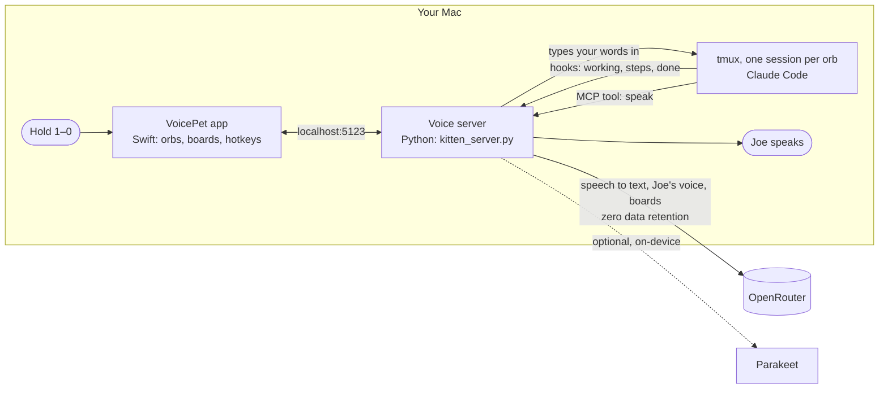

<div align="center">



**Every coding agent you run gets an orb on your Mac's screen.<br>Hold its number key, say what you want, let go. Joe, an unflappable British butler, tells you when it's done.**

[Website](https://ankushsrivastava0626.github.io/Orbs-Agents/) ·
[Install](#install) ·
[How it works](#how-it-works) ·
[Shortcuts](#shortcuts) ·
[Privacy](#where-your-voice-goes) ·
[FAQ](#faq) ·
[Docs](docs/)


</div>

---

You run three agents in three terminals. One finished ten minutes ago and has a question for you. One is still
working. You were reading the third. **Orbs Agents** turns each session into a small glowing orb you can read from
across the room and talk to without switching windows, so you can stop babysitting terminals and get on with your work.

- **Push to talk, per agent.** Hold <kbd>1</kbd>–<kbd>0</kbd> to talk to the orb in that slot; let go to send. A quick tap still types the number.
- **State at a glance.** Red is listening, coral is transcribing, green is sent, purple is working, blue is Joe speaking. Hover a purple orb to watch its live steps.
- **Answers you can hear.** Every orb's session speaks as Joe, in a calm British voice (Fish Audio Drama 3 or Gemini). He gives you the outcome and asks what he needs to know.
- **Interrupts, not queues.** A newer command to the same orb replaces one it hasn't sent yet. Holding any talk key silences Joe and mutes your speakers while you speak.
- **Voice everywhere else too.** Task cards, a meeting board with speaker labels, notes, and read-aloud for any selected text.
- **Careful with your data.** The server only listens on `127.0.0.1`. Every OpenRouter request asks for zero data retention. On-device transcription is one menu click away.
- **Native and light.** A Swift app plus a small Python server. No Electron and no browser in the loop.

## How it works

| | You | The orb |
|:-:|---|---|
|  | **Hold the orb's number key** and talk. Orbs are numbered left to right, <kbd>1</kbd> to <kbd>0</kbd>. | Turns red and grows with your voice. Your speakers mute so nothing echoes. |
|  | **Let go.** | Coral with a spinning arc while your words become text. |
|  | | A green flash: your words were typed into that session. |
|  | **Get on with your day.** Hover the orb if you're curious. | Purple with a spinning arc while the agent works. The hover card shows how long it's been working, the current step and the steps before. |
|  | **Listen.** | Blue while Joe tells you what happened, or asks the question the agent needs answered. |

Each orb is a real Claude Code session running in its own tmux session, so it survives restarts, keeps its
conversation, and is one click away in Terminal whenever you want to read along.

### What the colors mean

| Orb | Means | | Orb | Means |
|:-:|---|---|:-:|---|
|  | A Claude Code session, ready | |  | The session or the voice server is offline |
|  | A session running an OpenRouter model, ready | |  | Auto mode: talk without holding a key |
|  | A Codex session, ready | |  | Notes mode: what you say is saved as a note |
|  | Listening | |  | Something went wrong in the last two minutes. Hover to see what |
|  | Working (hover for live steps) | |  | Muted: replies show as text bubbles instead |

## Install

You'll need a Mac with **Apple silicon on macOS 15 or later**, [Homebrew](https://brew.sh),
[Claude Code](https://code.claude.com/docs/en/overview), and an
[OpenRouter key](https://openrouter.ai/keys) for transcription, Joe's voice and the boards.

```bash
brew install tmux python@3.12
```

```bash
git clone https://github.com/ankushsrivastava0626/Orbs-Agents ~/.claude/voice
```

```bash
~/.claude/voice/install.sh
```

The installer checks your Mac, builds the Python environment and the app, adds three small hooks to
`~/.claude/settings.json` (with a backup), and starts the voice server and the app at login. It's safe to run again,
and `--dry-run` shows what it would do first. Then:

1. Put your key in `~/.claude/voice/.env`. The installer creates the file; open it with `open -e ~/.claude/voice/.env` and fill in the line `OPENROUTER_API_KEY=sk-or-…`.
2. Allow **VoicePet** in System Settings › Privacy & Security › **Accessibility**. macOS asks for the microphone the first time you hold a key.
3. Click **+** at the bottom right of your screen › **New Claude session**, then hold <kbd>1</kbd> and talk.

Full details, local transcription, the Gemini voice and a stable signing identity are covered in [docs/INSTALL.md](docs/INSTALL.md).
To remove it, run `~/.claude/voice/install.sh --uninstall`; your notes, cards and meetings stay where they are.

## Shortcuts

| Do this | And |
|---|---|
| Hold <kbd>1</kbd> … <kbd>9</kbd>, <kbd>0</kbd> | Talk to the orb in that slot, counted left to right |
| Hold left <kbd>⌥</kbd> | Dictate a note. It shows for a moment; click it to fix a word before it's saved |
| Hold <kbd>`</kbd> | Start a new task card that records while you hold |
| Double-tap right <kbd>⌥</kbd> | Start or stop recording a meeting |
| Double-tap right <kbd>⌘</kbd> | Read the selected text aloud (again with nothing selected to stop) |
| Double-tap left <kbd>⌥</kbd> | Turn OS mode on or off |
| Push the pointer into the top-left corner | Quick look at every task card |
| Click an orb | Type to it instead of talking |
| Right-click an orb | Its menu: notes mode, mute, canvas, rename, system prompt, transcript, close |
| Drag an orb | Reorder the strip (which changes its number) |

## More than talking

<table>
<tr><td width="50%" valign="top">

**Task cards** · hold <kbd>`</kbd><br>
A card fills with your words as you speak, and AI turns them into a prompt that's ready to send. Flip between your
words and its version, edit either one, and push the pointer into the top-left corner to see every card at once.

</td><td width="50%" valign="top">

**Meeting board** · double-tap right <kbd>⌥</kbd><br>
Records your mic and your Mac's audio, transcribes it with speaker labels, and answers questions about the meeting
so far. The board is hidden from screen sharing, and past meetings are a menu away.

</td></tr>
<tr><td valign="top">

**Notes** · hold left <kbd>⌥</kbd><br>
Each thing you say becomes a timestamped line in your notes file. Point `NOTES_FILE` at your Obsidian vault if you like.

</td><td valign="top">

**Read aloud** · double-tap right <kbd>⌘</kbd><br>
Select text in any app and Joe reads it. Your clipboard is left exactly as it was.

</td></tr>
<tr><td valign="top">

**Session search** · **+** › Search sessions<br>
Browse past orb conversations by folder and model, or search their words, and reopen any of them in an orb.

</td><td valign="top">

**Per-orb system prompts**<br>
Give any OpenRouter orb its own instructions from its menu. They stay with that conversation.

</td></tr>
<tr><td valign="top">

**OS mode** · double-tap left <kbd>⌥</kbd><br>
A quiet full-screen workspace with its own menu bar, dock and app dial, with your orbs always in reach. Leaving it
puts your Dock and menu bar back.

</td><td valign="top">

**Focus timer and canvas**<br>
A pill timer that darkens your screens when it ends, and a canvas card that shows the latest reply as text when you'd
rather read than listen.

</td></tr>
</table>

## Where your voice goes

- **Nothing listens on your network.** The voice server answers on `127.0.0.1` only. It refuses any request that carries a web page's `Origin` header or a non-local `Host`, so a website can't drive it.
- **Zero data retention on every request.** Speech to text (AssemblyAI; ElevenLabs Scribe v2 for meetings), Joe's voice (Fish Audio) and the boards' model all go through OpenRouter. Each request asks for `zdr: true` and `data_collection: deny`.
- **Or keep speech on your Mac.** Switch transcription to Parakeet in the orb menu (Voice › Transcription › Local).
- **Silence isn't sent.** A local speech check (Silero VAD) drops recordings with no one talking before anything is uploaded.
- **Your key stays in your file.** The OpenRouter key is read from the file you choose each time it's needed, and is never copied, cached or logged.
- **Your data is plain files.** Notes, task cards, meeting transcripts and orb state live in `~/.claude/voice`, and git ignores all of them.

See [SECURITY.md](SECURITY.md) for the full model and how to report a problem.

## Architecture



- **`pet/`** is the Swift app (`VoicePet.app`). It draws the orbs and boards, watches the hotkeys through an event tap, and polls the server for state.
- **`kitten_server.py`** is the voice server. It records the mic, runs the speech check, transcribes, types the text into the right tmux session, speaks Joe's lines one at a time, and runs the task and meeting boards.
- **`start-voice-session.sh`** starts or resumes an orb's Claude Code session in tmux, with the `speak` tool (`voice_mcp.py`) and Joe's system prompt (`voice-system-prompt.md`).
- **`event.sh`** is the Claude Code hook that reports each session's state and steps to the server.

The full picture, with endpoints, threads and files, is in [docs/ARCHITECTURE.md](docs/ARCHITECTURE.md).

## Configuration

Settings live in `~/.claude/voice/config` (start from [`config.example`](config.example)). The orb menu switches the
common ones for you.

| Setting | Default | What it does |
|---|---|---|
| `STT_ENGINE` | `cloud` | `cloud` (AssemblyAI via OpenRouter) or `local` (Parakeet on your Mac) |
| `ENGINE` | `fish` | Joe's voice: `fish` (Fish Audio Drama 3), `gemini` (Gemini Live) or `kitten` (on-device) |
| `VOICE_MIC` | `MacBook` | The microphone to record from, by part of its name |
| `NOTES_FILE` | `~/.claude/voice/notes/notes.md` | Where notes go |
| `DEFAULT_CWD` | your home folder | Folder a new orb starts in when you don't pick one |
| `OPENROUTER_ENV` | `~/.claude/voice/.env` | File that holds `OPENROUTER_API_KEY=` |

Every setting, with its default, is listed in [docs/CONFIGURATION.md](docs/CONFIGURATION.md). Joe's character lives in
[`persona.txt`](persona.txt), and how orb sessions talk to you is in [`voice-system-prompt.md`](voice-system-prompt.md).
Edit either one to change him.

## FAQ

<details>
<summary><b>Does it work on Intel Macs, Linux or Windows?</b></summary>

No. It needs an Apple silicon Mac on macOS 15 or later. The app relies on macOS event taps, Accessibility and Core
Audio process taps.
</details>

<details>
<summary><b>Is it always listening?</b></summary>

No. It records only while you hold a key. Auto mode (teal ring) is the exception and listens hands-free until you
turn it off.
</details>

<details>
<summary><b>Do I need OpenRouter?</b></summary>

For cloud transcription, Joe's Fish Audio voice and the task and meeting boards, yes. You can transcribe on-device
with Parakeet, and Joe can use Gemini (a Google key in your Keychain) or the on-device Kitten voice. See
[docs/INSTALL.md](docs/INSTALL.md#optional-extras).
</details>

<details>
<summary><b>What does it cost to run?</b></summary>

Orbs Agents is free. Speech and voice are billed by OpenRouter per use, at the providers' prices. Recordings without
speech are dropped before upload, so you don't pay for silence.
</details>

<details>
<summary><b>Can I use models other than Claude?</b></summary>

Yes. **+** › **New orb with custom command…** runs any Claude Code–compatible command in an orb, for example a wrapper
that points Claude Code at OpenRouter. Orbs whose command mentions `openrouter` show rose, and you can give them their
own system prompt.
</details>

<details>
<summary><b>What about Codex?</b></summary>

Codex orbs talk to a companion Codex voice server on `127.0.0.1:5124`, which isn't part of this repo yet. Without it,
the Codex menu items stay disabled and everything else works.
</details>

<details>
<summary><b>Can I read what an agent is doing?</b></summary>

Hover its orb for the live steps, or open the orb's menu › More › Show in Terminal to attach to its tmux session.
</details>

<details>
<summary><b>My Dock or menu bar stayed hidden.</b></summary>

OS mode hides them while it's on and restores them when you leave it or quit. If the app was killed while OS mode was
on, start it again (`launchctl kickstart -k gui/$(id -u)/com.claude.voice-pet`) and it restores them.
</details>

More answers are in [docs/TROUBLESHOOTING.md](docs/TROUBLESHOOTING.md).

## Roadmap

- [ ] Publish the Codex voice server
- [ ] A signed, notarized release so you don't need the Command Line Tools
- [ ] A settings window instead of the config file
- [ ] A Homebrew cask

Ideas and pull requests are welcome; see [CONTRIBUTING.md](CONTRIBUTING.md).

## Contributing

Bug reports, ideas and pull requests are all welcome. [CONTRIBUTING.md](CONTRIBUTING.md) covers the layout, building,
testing and the few design rules the app sticks to. Please follow the [code of conduct](CODE_OF_CONDUCT.md).

## Thanks

Orbs Agents stands on [Claude Code](https://code.claude.com/docs/en/overview),
[tmux](https://github.com/tmux/tmux), [OpenRouter](https://openrouter.ai), [AssemblyAI](https://www.assemblyai.com),
[ElevenLabs](https://elevenlabs.io), [Fish Audio](https://fish.audio), [MiniMax](https://www.minimax.io),
[Silero VAD](https://github.com/snakers4/silero-vad), NVIDIA's Parakeet through
[MacParakeet](https://macparakeet.com), Google Gemini and [KittenTTS](https://github.com/KittenML/KittenTTS).

## Star history

<a href="https://star-history.com/#ankushsrivastava0626/Orbs-Agents&Date">
  
</a>

## License

[MIT](LICENSE) © 2026 Ankush Srivastava. Orbs Agents isn't affiliated with Anthropic, OpenAI, OpenRouter or any of the
providers above.
