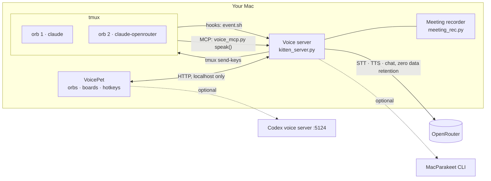
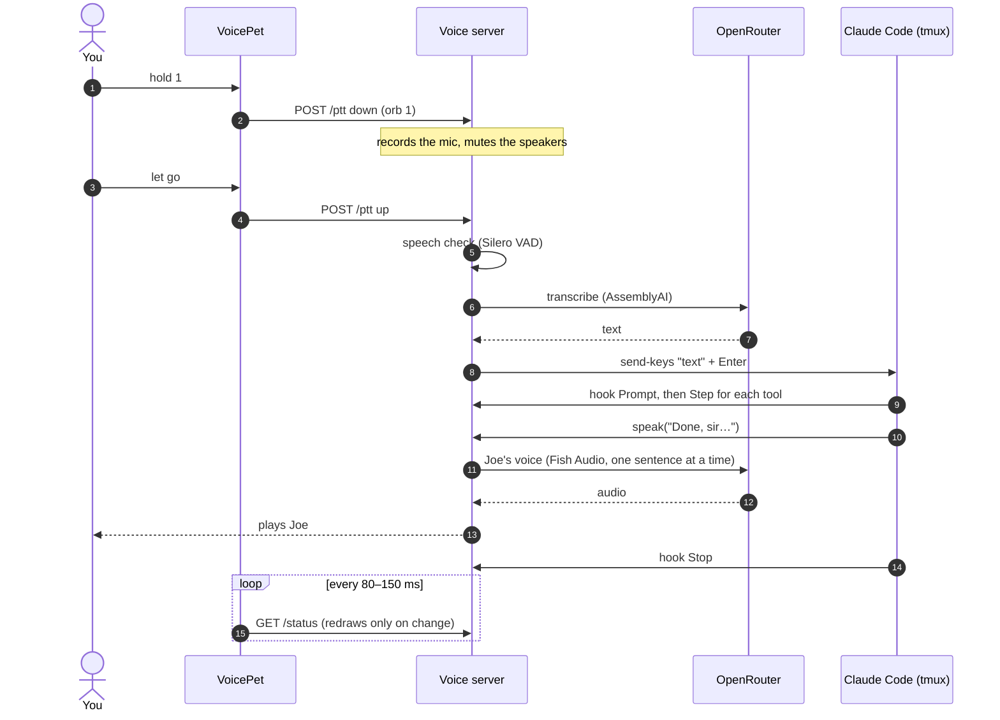

# How Orbs Agents is built

Two long-running programs, both started at login by launchd:

- **VoicePet** (`pet/`, Swift with AppKit and SwiftUI) draws the orbs, bubbles, boards and OS mode, and watches the
  keyboard through an event tap. It has no Dock icon (`LSUIElement`).
- **The voice server** (`kitten_server.py`, Python 3.12) owns the microphone and the speakers. It transcribes, types
  into sessions, speaks Joe's lines and runs the task and meeting boards. It answers HTTP on `127.0.0.1:5123`.

Each orb is a **Claude Code session in its own tmux session**, started by `start-voice-session.sh`.



## One command, start to finish



## Where each piece lives

| Path | What it is |
|---|---|
| `pet/*.swift`, `pet/build.sh` | The app. `VoicePet.swift` is the entry point, orb drawing and menus. `Sessions.swift` handles orbs, the hotkey tap and the orb menu. `Captions.swift` draws bubbles and the live activity card. `TaskBoard.swift`, `MeetingBoard.swift`, `Canvas.swift`, `Pomodoro.swift`, `TaskTimer.swift`, `SessionSearch.swift` and `TypeBox.swift` are what their names say. `OSMode.swift`, `MenuBar.swift`, `Dock.swift` and `Connectivity.swift` are OS mode. `SystemAudio.swift` is the Core Audio tap for meetings. |
| `kitten_server.py` | The voice server |
| `meeting_rec.py` | Records meetings in its own process, so a server restart never cuts one off |
| `start-voice-session.sh` | Starts or resumes an orb: tmux session, Claude Code flags, `speak` tool, Joe's system prompt, per-conversation prompt |
| `voice_mcp.py`, `voice-mcp.json` | The `speak` MCP tool that every orb session gets |
| `event.sh`, `voice-hooks.json` | Claude Code hook: working, the current step in words ("Reading TaskBoard.swift"), done |
| `orb_search.py`, `orb_last_session.py`, `voice_sessions.py` | Session search and the last-line recovery |
| `orb_agent.py` | Starts agents designed in CUE Studio as orbs |
| `gemini_voice.py`, `keep_resident.py`, `wav_repair.py`, `moved_paths.py` | Gemini Live voice, memory pinning, WAV recovery, folders that moved |
| `persona.txt`, `voice-system-prompt.md` | Joe's character, and the rules orb sessions follow (speak through `speak`, ask before anything irreversible) |
| `speak`, `toggle`, `mute`, `osmode`, `tunnel` | Small command-line helpers |
| `system/*.plist` | Login-agent templates the installer fills in |

## The voice server's HTTP interface

Everything is on `127.0.0.1:5123`. Any request with an `Origin` header, or with a `Host` other than localhost, gets
`403`, so web pages can't reach it, even through DNS rebinding.

| Request | Does |
|---|---|
| `GET /status` | Everything the app draws: each orb's state and steps, what was heard, captions, notes, meetings |
| `GET /task`, `GET /meeting/live` | Task cards and recording state; the live meeting view |
| `POST /ptt` | Talk key down, up or cancel, from the app |
| `POST /target` | Which orb your voice goes to |
| `POST /event` | Session state from `event.sh` |
| `POST /type` | A typed message for an orb |
| `POST /?kind=say\|report&s=<orb>` | Queue a line for Joe (used by `speak`) |
| `POST /stop` | Silence Joe and clear his queue |
| `POST /mute`, `/notes`, `/auto` | Per-orb mute, notes mode, auto mode |
| `POST /settings?STT_ENGINE=…&ENGINE=…` | Switch transcription or Joe's voice (writes `config`) |
| `POST /note/{propose,hold,commit,discard}` | The note card |
| `POST /task/{record,new,ask,delete,hide,showall,edit}` | Task cards |
| `POST /meeting`, `/meeting/{open,prompt,ask}` | Meetings and the meeting board |
| `POST /claude/{stop,quit,show}?s=<orb>` | Stop an orb's current task, close it, or show it in Terminal |

## Rules the code follows

- **Interrupt, don't queue.** A newer hold to the same orb drops an older recording that hasn't been sent. A new task
  card recording replaces the one being transcribed. A newer batch of meeting prompts replaces an older one. Joe's
  lines are the exception: they play in order, so two orbs finishing at once are both heard.
- **No silent fallbacks.** If transcription or Joe's voice fails, the audio is kept, the reason shows on the orb
  (orange dot and a card), and nothing quietly switches to another provider.
- **Never lose what you said.** Failed recordings go to `failed/`, lines spoken while the server is down wait in
  `spool/`, and cut-off meetings are recovered and transcribed.
- **Keys at call time.** The OpenRouter key is read from its file for each request and never stored, cached or logged.
- **Light on the Mac.** The app redraws only when the status actually changes, keeps one request in flight, and slows
  its polling when idle. All Accessibility calls have a short timeout so a hung app can't freeze the keyboard tap.

## Privacy on every OpenRouter request

Every request (speech to text, Joe's voice, the boards) carries:

```json
"provider": { "zdr": true, "data_collection": "deny", "sort": "throughput" }
```

That asks OpenRouter to route only to providers with zero data retention that don't train on your data, fastest
first.
